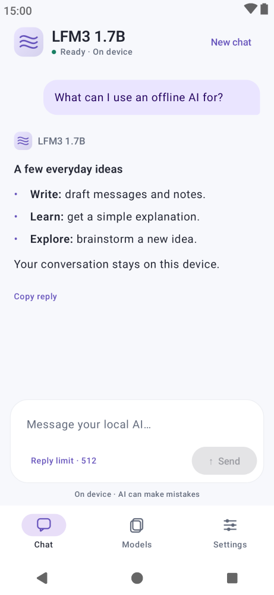
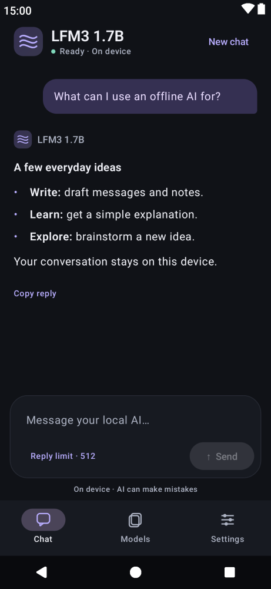
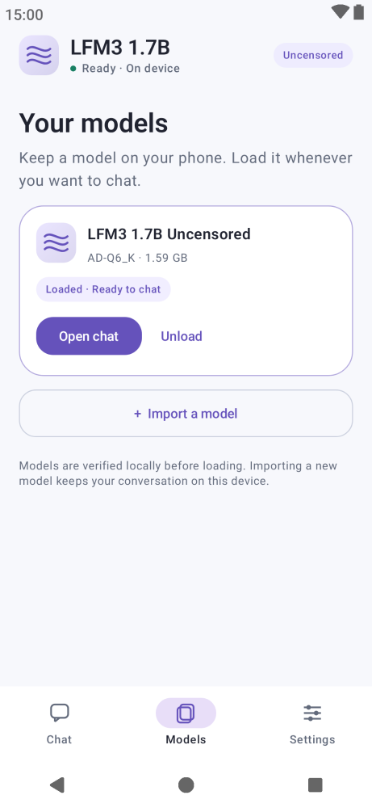
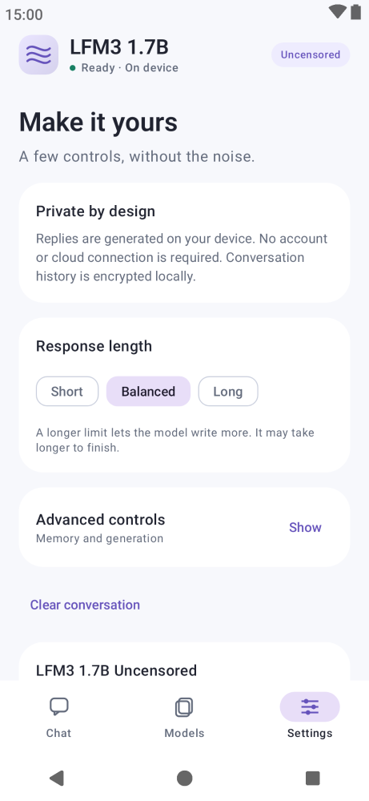

# LFM3 1.7B Uncensored for Android

An unofficial offline Android preview for [AtomicChat's refusal-reduced LFM3-1.7B GGUF](https://huggingface.co/AtomicChat/LFM3-1.7B-Uncensored-GGUF), based on Liquid AI's model. Derived from the MeshMind Android runner. This project is not affiliated with Liquid AI or AtomicChat.

The app runs text inference directly through JNI on the CPU. It supports streaming chat, cancellation, background cancellation, local GGUF import, encrypted local chat history, and adjustable generation settings. It requests no Internet permission and starts no inference server.


## UI previews

Actual Compose UI rendered with a fixed **English** sample question and answer. These are layout previews, not physical-device screenshots or model-quality evidence. [Capture details and reproduction](tools/ui-preview).

<p>
  
  
</p>
<p>
  
  
</p>

Markdown replies display headings, bold, lists, tables, links and code blocks. Reasoning, when provided, is collapsed separately from the final answer. Code and reply text can be copied. System light/dark mode, model management and generation controls share the same interface.


## Install

Use the ARM64 bundled preview APK from [Releases](https://github.com/gdalabs/lfm3-1.7b-uncensored-android/releases/tag/v0.1.1-preview) on Android 9 or later. This is an experimental, non-debuggable release APK signed with the existing Android debug identity for preview updates; phone execution, device memory requirements, thermal behavior, and production signing remain pending.

The bundled AD-Q6_K model is about 1.59 GB. Installation and first-launch provisioning need space for both the APK and its private model copy; allow at least 4 GB of free storage plus working headroom. Additional RAM is required beyond the model file size.

1. Install the APK and keep the app in the foreground while its bundled model is provisioned.
2. Tap **Load model & start** on Chat, or load it from **Models**.
3. Send a message. **Stop** cancels generation; **New chat** clears the conversation after confirmation.

The refusal edit is baked into the bundled weights. Switching behavior requires loading a different model, rather than toggling a separate LoRA. A manifest for the matching unedited AtomicChat AD-Q4_K_M model is included for optional manual import over USB.

An optional AD-Q4_K_M manifest is also included for a smaller 1.13 GB model. Provision it on a computer with `python3 scripts/fetch-model.py /path/to/lfm3-q4.gguf --format q4`, transfer it over USB, select its manifest under Models → Import a model, and import it. The latest bundled APK uses AD-Q6_K.

## Build

Use JDK 17, Android SDK 36, NDK 28.2.13676358, CMake 3.31.6, and Python 3.12 or later. Gradle dependency verification and locking remain enabled.

```sh
python3 scripts/fetch-upstream.py
python3 scripts/fetch-model.py /path/to/lfm3-uncensored.gguf
./gradlew --no-daemon -PmeshmindBundledModel=/path/to/lfm3-uncensored.gguf \
  -PmeshmindBundledFormat=AD-Q6_K :android-app:assembleRelease
ANDROID_HOME=/path/to/android-sdk python3 scripts/check-apk.py \
  android-app/build/outputs/apk/release/android-app-release.apk --bundled
```

Omit the model property to build a small runner APK that provisions its model through local import. The app itself does not download models. The application ID is `org.meshmind.app.lfm3.uncensored`, allowing installation alongside the existing MeshMind and Bonsai Local apps.

Exact source/model revisions, sizes, and hashes are in `dependencies.json` and `model-manager/manifests/`. The runtime is upstream llama.cpp `19cce6919992fdffd92e0ac152caaf1e2b8f254e`, which includes LFM3 support. The older Bonsai runtime is not used by this build.

## Validation

See `VALIDATION.json` for executed checks and remaining device validation. Host tests and cross-compilation do not establish successful execution on an Android phone. Refusal editing does not establish factual accuracy or consistent compliance.

For opt-in phone instrumentation, install the matching test APK and run:

```sh
adb shell am instrument -w -e runLfm3 true \
  org.meshmind.app.lfm3.uncensored.test/androidx.test.runner.AndroidJUnitRunner
```

This provisions the bundled model and records a synthetic response and inference statistics. It does not run automatically on app startup.

## Licenses

- Application: GPL-3.0-only; see `LICENSE`.
- llama.cpp and native dependencies: MIT and their respective bundled notices.
- LFM3 and the AtomicChat model derivative: LFM Open License v1.0, **not Apache-2.0**. See `docs/notices/LFM-Open-License-1.0.txt` and the model publisher's card.
- Android libraries: notices in `docs/notices/RUNTIME-LICENSES.txt`.

Full notices are included in the source and APK assets. The app's license does not relicense the model weights.
